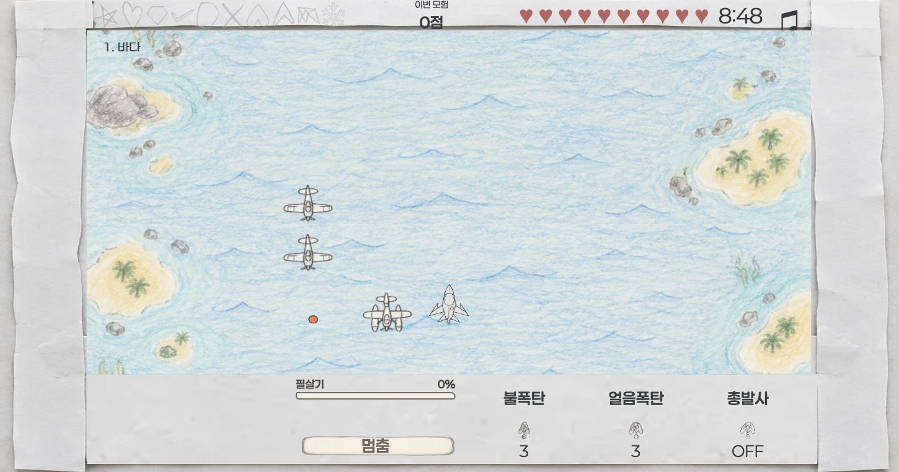
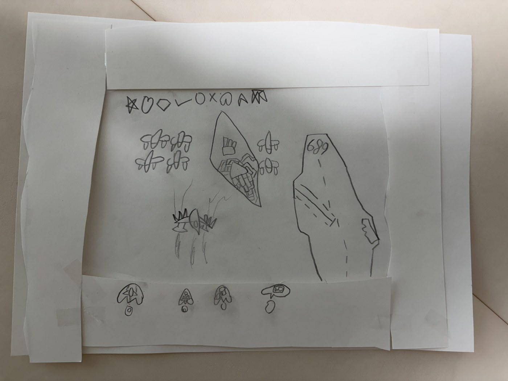
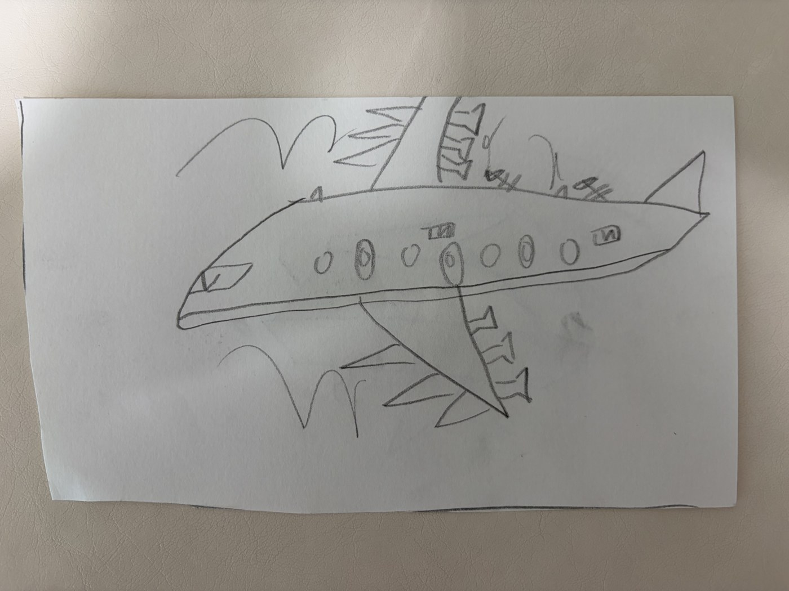

# 유준이의 종이 비행 ✈️

아이가 종이에 그린 게임판과 비행기들이 아이패드에서 움직이는, 종이·연필 느낌의 슈팅게임입니다.

**[게임 플레이하기](https://yujun-paper-flight.holymolywhattheai.chatgpt.site/)** · 한국어 / 日本語 · iPad 가로 화면



## 어느 날 아침, 아이가 게임을 가져왔다

어느 날 아침, 유준이가 종이 비행기 그림들과 종이로 만든 프레임을 가져왔습니다. 자기가 만든 게임이라고 했습니다.

처음에는 아이가 그린 비행기 그림이라고 생각했습니다. 그런데 설명을 듣다 보니 그림만 있는 게 아니었습니다. 가운데 네모는 게임 화면이고, 옆에는 조작하는 버튼이 있었습니다. 어떤 비행기가 나오고, 버튼을 누르면 무슨 일이 일어나고, 적을 이기면 무엇을 받는지까지 아이의 설명은 구체적이었습니다.

그 이야기에 놀랐습니다. 아이의 머릿속에서는 이미 게임이 돌아가고 있었습니다. 이걸 실제로 움직이는 게임으로 만들어 보여줘야겠다고 마음먹었습니다.



그래서 아이가 만든 게임판과 비행기들을 사진으로 찍었습니다. 종이 위에 그어진 선과 조금씩 다른 날개 모양을 출발점으로 삼아, 화면에 쓰일 프레임과 버튼, 기체 선택 이미지, 위에서 본 비행기와 움직임용 스프라이트로 옮겼습니다. 그림을 반듯하게 바꾸는 것보다 아이가 알아볼 수 있는 모습을 남기는 데 신경 썼습니다.



사진이 에셋이 되고, 에셋에 움직임이 붙고, 버튼을 누르면 총알과 폭탄이 나가기 시작했습니다. 아이가 설명하던 규칙도 하나씩 게임 안으로 들어왔습니다. 스테이지를 깨면 보석을 모으고, 새로운 기체를 열고, 카드를 고르면 공격의 모양이 달라집니다. 그렇게 종이 위의 게임을 실제로 만질 수 있는 게임으로 만들어 갔습니다.

이 저장소는 그 제작 기록이자 실행 가능한 소스입니다. 어른이 준비한 게임을 아이에게 건네는 대신, 아이가 먼저 만든 세계를 따라가며 구현한 작업입니다.

## 종이에서 화면까지

1. **촬영** — 아이가 그린 게임판, 버튼, 비행기, 보석을 사진으로 기록했습니다.
2. **에셋화** — 원화를 참조해 imagegen으로 선택 이미지·공격·배경·효과를 만들고, sprite-gen 작업으로 프레임을 추출·정렬했습니다.
3. **구현** — TypeScript와 Canvas 2D로 전투를 만들고, HTML UI로 카드·메뉴·기체 선택 화면을 구성했습니다.
4. **연출** — HyperFrames로 출격·경고·필살기·클리어 영상 작업을 진행하고 실시간 게임 연출과 연결했습니다.
5. **플레이하며 보완** — 카드의 전후 차이, 공격 범위, 한글 줄바꿈, 동시 터치, 저장과 이어하기, 아이패드 화면 채움을 반복해서 조정했습니다.

원본 그림과 AI 보조 제작 에셋을 함께 사용합니다. 이 공개본에는 실행용 결과물과 대표 원화 사진을 포함하며, 전체 생성 원본·작업 중 파일·배포용 인증 정보는 포함하지 않습니다.

## 어떤 게임인가요?

- 8종의 기체와 서로 다른 기본공격·특수공격·필살기
- 바다에서 종이 요새까지 이어지는 10스테이지
- 중간보스와 스테이지 클리어를 통해 총 19번 고르는 성장 카드
- 공격의 갈래·분열·관통, 친구 비행기와 회전 방패
- 스테이지 보석, 기체 해금, 전체 완주 횟수에 따른 메달 재질 변화
- 한국어·일본어 UI와 로컬 글꼴
- 이용 시간 설정, 부활, 로컬 저장과 이어하기
- 최초 캐시 준비 후 오프라인 실행

## 조작

| 조작 | 터치 | 키보드 |
| --- | --- | --- |
| 이동 | 왼쪽 빈 영역에 손을 대면 나타나는 스틱 | 방향키 |
| 특수공격 1 | 오른쪽 세 버튼 중 왼쪽 | Z |
| 특수공격 2 | 오른쪽 세 버튼 중 가운데 | X |
| 기본공격 ON/OFF | 오른쪽 세 버튼 중 오른쪽 | Space |
| 필살기 | 게이지가 가득 차면 나타나는 버튼 | C |

상단 시간을 누르면 보호자 시간 설정을 열 수 있습니다. 데모용 코드 `1003`으로 10분 또는 20분을 설정합니다. 이는 클라이언트에 공개된 편의 기능이며 보안 인증 장치가 아닙니다.

## 내 컴퓨터에서 실행하기

Node.js 22.12 이상을 권장합니다.

```bash
npm ci
npm run dev -- --port 4173
```

브라우저에서 `http://localhost:4173`을 엽니다. 게임은 가로 화면용이며 세로 화면에서는 회전 안내를 표시합니다.

```bash
npm test
npm run build
npx vite preview --host 0.0.0.0 --port 4176
```

개발 서버는 게임을 직접 실행합니다. 빌드된 사이트는 바깥 페이지와 같은 출처의 `/play.html` 게임 화면으로 구성됩니다. 오프라인 기능은 프로덕션 빌드에서 확인할 수 있습니다.

에셋 경로는 `/assets/...`처럼 사이트 루트를 기준으로 합니다. `dist/`를 도메인 루트에 제공하는 HTTPS 정적 호스팅을 사용하세요. GitHub Pages의 저장소 하위 경로에 그대로 올리는 구성은 지원하지 않으며, 이 저장소는 소스 공개용입니다. 플레이 링크는 기존 Sites 배포를 사용합니다.

### 브라우저 검증

```bash
npx playwright install chromium webkit
# 개발 서버를 4173에서 실행한 상태로
npm run test:e2e
```

프로덕션 외부 프레임 검사는 빌드 미리보기 서버를 실행한 후 별도로 수행합니다.

```bash
PAPER_SHELL_URL=http://localhost:4176 npx playwright test e2e/shell.spec.ts
```

## 구성

```text
src/               전투·공격·카드·렌더링·저장·오디오·UI
public/assets/     기체·배경·효과·보석·메달·글꼴·효과음
public/sw.js       오프라인 캐시와 미디어 Range 응답
scripts/           빌드·캐시 목록·밸런스 검사
tests/             규칙 및 회귀 단위 테스트
e2e/               Playwright 브라우저 테스트
docs/images/       실제 게임 화면과 대표 원화 사진
```

서버 계정 없이 `localStorage`에 진행을 저장합니다. 주소·브라우저·홈 화면 앱의 저장 영역이 다르면 기록이 공유되지 않을 수 있고, 사이트 데이터를 지우면 기록도 사라집니다. 첫 접속과 업데이트에는 인터넷이 필요합니다.

## 공개본의 범위와 알려진 문제

공개본은 Sites v26 소스를 기준으로 정리했습니다. 배포 관리 파일과 개인 작업 경로는 제외했습니다. 배경음악은 재배포 권한 확인 전까지 제외했으며, 빈 `public/assets/music/tracks.json`으로 음악 없이도 플레이할 수 있습니다. 효과음은 포함합니다.

iPadOS 27.0.1 홈 화면 앱에서 상단 시스템 흐림이 겹치는 현상은 아직 해결이 확인되지 않았습니다. 소리 설정의 **화면 점검**에서 기본·모험 게임 방식·상단 고정 배경을 비교할 수 있습니다. 데스크톱 Chrome/WebKit 검사 통과를 실제 아이패드 해결로 간주하지 않습니다.

## 출처와 이용 권한

- 종이 게임판·비행기 원화: 유준이의 그림. 공개 사진의 촬영 메타데이터는 제거했습니다.
- 실행용 그림·영상·합성음: 원화를 바탕으로 진행한 프로젝트 제작 결과물.
- Kenney 효과음: [Sci-fi Sounds](https://kenney.nl/assets/sci-fi-sounds), [Impact Sounds](https://kenney.nl/assets/impact-sounds), [Interface Sounds](https://kenney.nl/assets/interface-sounds), CC0. 사용 목록과 라이선스는 `public/assets/sfx/`에 있습니다.
- Paperlogy와 Noto Sans JP: 각 SIL Open Font License 문서를 `public/assets/fonts/`에 동봉했습니다.

공개 저장소라는 이유만으로 프로젝트 코드·원화·제작 에셋에 포괄적인 재사용 라이선스를 부여하지는 않습니다. 별도 라이선스를 지정하지 않았으며, 제3자 에셋은 각 동봉 라이선스를 따릅니다.
